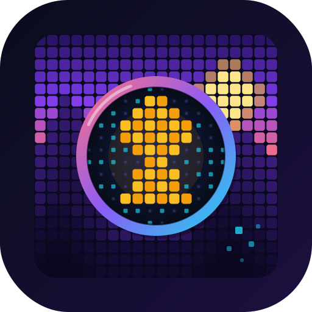
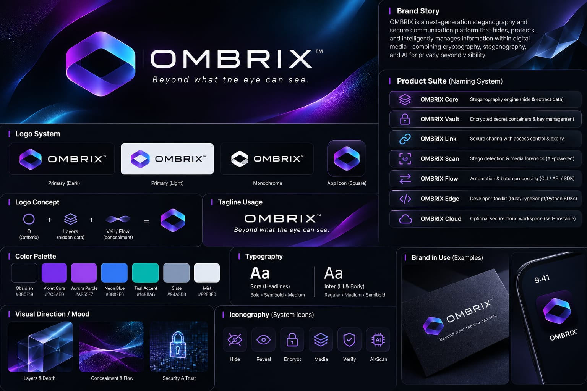

<div align="center">



# OMBRIX

### Zero-Telemetry Forensic Steganography & Visual Cryptanalysis Suite

**Client-side covert communication, multi-detector steganalysis, and sandboxed AI agent tooling.**  
*Engineered for absolute local privacy — zero network calls, zero telemetry, zero forensic residue.*

<br/>

[](https://ombrix-stego.vercel.app/)
[](https://www.npmjs.com/package/ombrix-cli)
[](https://www.npmjs.com/package/ombrix-mcp-server)
[](https://m8ven.ai/mcp/santhakumar-k-2004/ombrix?s=readme)
[-10B981.svg?style=for-the-badge&logo=vitest&logoColor=white)](https://github.com/SanthaKumar-K-2004/OMBRIX/actions)
[](https://github.com/SanthaKumar-K-2004/OMBRIX)
[](https://opensource.org/licenses/MIT)

<br/>



</div>

---

## ⚡ Quick Navigation

- [Executive Overview](#-executive-overview)
- [Quick Start Guide](#-quick-start-guide)
  - [Web Studio](#1-web-application-zero-install)
  - [Command Line (CLI)](#2-command-line-interface-cli)
  - [Model Context Protocol (MCP 2.0)](#3-model-context-protocol-mcp-20-for-ai-agents)
- [7 Steganography Engines](#-7-steganography-engines)
- [4 Unified Passkey Modalities](#-4-unified-passkey-modalities)
- [Forensic Steganalysis & Detection Engine](#-forensic-steganalysis--detection-engine)
- [8 Specialized Web Studios](#-8-specialized-web-studios)
- [Architecture & Data Pipeline](#-architecture--data-pipeline)
- [Zero-Telemetry & Security Guarantees](#-zero-telemetry--security-guarantees)
- [Scientific Limitations & Honest Engineering Disclosure](#-scientific-limitations--honest-engineering-disclosure)
- [Published npm Packages](#-published-npm-packages)
- [Verification & Automated Test Matrix](#-verification--automated-test-matrix)

---

## 🔬 Executive Overview

**OMBRIX** is a client-side steganographic workstation and forensic suite designed to conceal authenticated, encrypted payloads inside lossless PNG images while actively evading statistical detection. 

Traditional LSB (Least Significant Bit) tools introduce systematic statistical anomalies—such as Pairs-of-Values (PoV) histogram flattening—that make concealed data trivial to detect using **Sample Pair Analysis (SPA)**, **RS Steganalysis**, or **Chi-Square ($\chi^2$)** tests. 

OMBRIX counters statistical steganalysis using multi-domain concealment:
- **High-Frequency Wavelet Decomposition**: Embedding into 2D Haar DWT high-frequency subbands where optical and statistical sensitivity is lowest.
- **Human Visual System (HVS) Edge Adaptation**: Pixel Value Differencing (PVD) allocates entropy to textured contours and edges, preserving smooth image gradients.
- **Statistical Invariance**: $\pm 1$ LSB Matching modulo arithmetic eliminates histogram step-equalization artifacts.
- **Dual-Layer Social Media Resilience**: Hybrid spatial dipole modulation with 5× Forward Error Correction (FEC) allows small payloads to survive lossy recompression (such as messaging platform photo pipelines), while uncompressed document transfers deliver full multi-megabyte capacity.

> [!NOTE]
> All encryption and embedding runs entirely in your local browser or terminal process via Libsodium WebAssembly. No server ever sees your carrier images, keys, or plaintext.

---

## 🚀 Quick Start Guide

### 1. Web Application (Zero-Install)
Launch the browser studio immediately with full client-side WebAssembly cryptography:
👉 **[Open OMBRIX Studio (https://ombrix-stego.vercel.app)](https://ombrix-stego.vercel.app/)**

### 2. Command Line Interface (CLI)
Run directly via `npx` (no global installation required) or install globally:

```bash
# Run directly with npx
npx ombrix-cli --help

# Or install globally
npm install -g ombrix-cli
```

#### Core CLI Commands:
```bash
# 1. Embed data into a carrier image using Universal Hyper-Matrix & a passkey
ombrix embed cover.png -p "Classified Coordinates" -k "correct-horse-battery-staple" -o stego.png

# 2. Extract concealed message with smart auto-detection
ombrix extract stego.png -k "correct-horse-battery-staple"

# 3. Use an image as a 32-byte cryptographic key (Photo Key)
ombrix embed cover.png -p "Sensitive Payload" --key-image key-photo.png -o stego.png
ombrix extract stego.png --key-image key-photo.png

# 4. Run multi-detector forensic steganalysis on any image
ombrix scan suspect-carrier.png

# 5. Inspect available embedding capacity across all 7 algorithms
ombrix inspect cover.png

# 6. Benchmark algorithms for visual distortion (PSNR, MSE, SSIM)
ombrix benchmark cover.png

# 7. Generate cryptographic passkeys (Diceware, Crypto32 token, Photo key, Keypair)
ombrix keygen diceware
ombrix keygen crypto32
ombrix keygen photo /path/to/key.jpg
```

---

### 3. Model Context Protocol (MCP 2.0) for AI Agents

OMBRIX provides a production-hardened **Model Context Protocol (MCP 2.0)** server, allowing AI coding assistants (**Google Antigravity**, **Claude Desktop**, **Cursor IDE**, **Claude Code CLI**, **Windsurf IDE**) to embed, extract, inspect, and forensically analyze steganographic images.

#### A. Automated One-Command Configuration (Recommended)
OMBRIX includes an automated MCP client installer that scans your operating system, detects installed AI assistants, and safely injects the OMBRIX MCP configuration directly into each client's config file (with an automatic timestamped backup):

```bash
# Run auto-installer (zero installation required via npx):
npx -y ombrix-cli mcp install

# Or if ombrix-cli is installed globally:
ombrix mcp install
```

The installer automatically detects and configures:
- 🤖 **Google Antigravity**: `~/.gemini/antigravity/mcp_config.json`
- 🖥️ **Claude Desktop**: 
  - macOS: `~/Library/Application Support/Claude/claude_desktop_config.json`
  - Linux: `~/.config/Claude/claude_desktop_config.json`
  - Windows: `%APPDATA%\Claude\claude_desktop_config.json`
- 💻 **Cursor IDE**: `~/.cursor/mcp.json`
- ⌨️ **Claude Code CLI**: `~/.claude.json`
- 🌊 **Windsurf IDE**: `~/.codeium/windsurf/mcp_config.json`

> [!TIP]
> You can also target a specific client directly without prompts:
> ```bash
> ombrix mcp install antigravity   # Configure Google Antigravity
> ombrix mcp install claude        # Configure Claude Desktop
> ombrix mcp install cursor        # Configure Cursor IDE
> ombrix mcp install claude_code   # Configure Claude Code CLI
> ombrix mcp install windsurf      # Configure Windsurf IDE
> ```

#### B. Standalone Installation & CLI Inspection
```bash
# Install MCP server globally via npm:
npm install -g ombrix-mcp-server

# Print ready-to-copy JSON configuration blocks for all clients:
ombrix mcp show

# Run the MCP server directly over stdio:
ombrix mcp run
# Or standalone:
npx -y ombrix-mcp-server
```

#### C. Remote Cloud MCP & Catbox.moe Workflow
For cloud-hosted AI agents or remote containers (e.g. Hugging Face Spaces):
```json
{
  "mcpServers": {
    "ombrix": {
      "url": "https://<your-space>.hf.space/sse"
    }
  }
}
```

> [!IMPORTANT]
> **Why Catbox.moe for Remote MCP?**  
> Cloud-hosted MCP servers cannot read local filesystem paths (`/home/...` or `C:\...`), and embedding large images as Base64 strings can quickly exhaust LLM context windows.  
> Most consumer image hosts (Imgur, Discord, social media) secretly recompress or convert PNGs to lossy formats, destroying steganographic bits.  
> **Catbox.moe** (`files.catbox.moe`) provides direct, unaltered, uncompressed PNG hosting. Upload your carrier to [Catbox.moe](https://catbox.moe) and pass the direct URL (`carrierUrl: "https://files.catbox.moe/xxxx.png"`) to `stego_embed` or `stego_extract`. The server will fetch and process the pristine bitstream without any local file limitations.

#### 11 Production MCP Tools:
| Tool Name | Scope & Functionality |
| :--- | :--- |
| `stego_embed` | Embed arbitrary data into PNG carriers with choice of 7 algorithms and passkey encryption. |
| `stego_extract` | Extract hidden data with auto-detection across all supported steganographic methods. |
| `stego_hide` | High-level, zero-friction embedding tool with in-memory self-verification. |
| `stego_reveal` | High-level extraction tool returning recovered plaintext with prompt-injection defenses. |
| `stego_scan` | Comprehensive forensic steganalysis (RS, SPA, Laplacian noise residuals, Chi-square). |
| `stego_inspect` | Carrier dimension and usable byte capacity analysis across all 7 algorithms. |
| `stego_benchmark` | Empirical fidelity benchmark measuring MSE, PSNR, and SSIM per algorithm. |
| `stego_keygen` | Cryptographic passkey generator (Diceware, 32-byte token, Photo key, X25519/Ed25519). |
| `stego_plan` | Channel-aware engine recommending optimal methods based on transmission channel. |
| `stego_code_mode` | Air-gapped sandboxed JavaScript execution inside an isolated worker thread. |
| `stego_api_docs` | Reference documentation for Code Mode scripts. |

---

## 🧬 7 Steganography Engines

OMBRIX implements 7 distinct steganographic algorithms, allowing you to select the optimal trade-off between payload capacity, visual fidelity, and channel resilience.

| Algorithm ID | Mathematical Domain | Primary Use Case | Detectability (RS / SPA) | Typical Capacity | Resilience |
| :--- | :--- | :--- | :---: | :---: | :---: |
| **`hyper-matrix`** | 2D Haar DWT + Edge PVD + $\pm 1$ LSB | **Default / Gold Standard**: High-capacity documents and photos sent via uncompressed channels. | **Undetectable** | 15% – 25% of carrier | Lossless (PNG/File) |
| **`robust-resilient`** | YCbCr Luminance Sub-Quadrants | **Social Media / Messaging**: Survives lossy JPEG recompression and downscaling. | Moderate | 56 B – 3 KB (5× FEC) | **Lossy JPEG 75+** |
| **`matching`** | Spatial RGB $\pm 1$ Modulo Arithmetic | Low visual distortion; evades Pairs-of-Values histogram analysis. | Clean | 12% – 20% of carrier | Lossless (PNG/File) |
| **`pvd`** | Pixel Value Differencing (Wu & Tsai) | High-contrast, textured, and urban photographs. | Low | 20% – 35% of carrier | Lossless (PNG/File) |
| **`dwt`** | 2D Integer Haar Wavelet Subbands | High-frequency detail modulation ($HH$ subband). | Very Low | 10% – 18% of carrier | Lossless (PNG/File) |
| **`dct`** | 8×8 Block DCT AC Coefficients | JPEG-frequency aligned AC coefficient modulation. | Low | 8% – 15% of carrier | Lossless (PNG/File) |
| **`lsb`** | Sequential RGB Bit-Plane 0 | Baseline sequential replacement for synthetic test patterns. | Detectable | ~37.5% of raw bytes | Lossless (PNG/File) |

> [!TIP]
> **Channel Rule:** When transmitting carriers over messaging apps (WhatsApp, Telegram, Signal, Discord, Slack), select **Send as File / Document** to preserve lossless PNG bit integrity. If sending as a standard compressed photo, use **`robust-resilient`** or **`hyper-matrix`** with small payloads.

---

## 🔑 4 Unified Passkey Modalities

OMBRIX unifies all four passkey encryption modalities across the **Web App**, **CLI**, and **MCP Server**, backed by **Argon2id** password-based key derivation ($19\text{ MiB}$ memory cost, 3 iterations) and **XChaCha20-Poly1305** authenticated encryption:

```
┌────────────────────────────────────────────────────────────────────────┐
│                   OMBRIX 4-PASSKEY ENCRYPTION MATRIX                   │
├─────────────────────────┬──────────────────────────────────────────────┤
│ 1. Memorable Words      │ Diceware 4-Word Mnemonic (64 bits entropy)   │
│    (Human Friendly)     │ Normalization: "correct-horse-battery-staple"│
├─────────────────────────┼──────────────────────────────────────────────┤
│ 2. Photo as Key         │ Any JPG/PNG image file as 256-bit key        │
│    (Air-Gapped Entropy) │ Perceptual Hash (DCT) OR Raw Byte BLAKE2b    │
├─────────────────────────┼──────────────────────────────────────────────┤
│ 3. 32-Byte Token        │ Formatted Cryptographic Hex Token (256 bits) │
│    (Machine High-Grade) │ Formatted: "8F3A-C4E2-..." ⟷ Raw 64-hex hex  │
├─────────────────────────┼──────────────────────────────────────────────┤
│ 4. Device Biometrics    │ WebAuthn Hardware Authenticator              │
│    (Hardware Enclave)   │ Touch ID / Face ID / Windows Hello Enclave   │
└─────────────────────────┴──────────────────────────────────────────────┘
```

### 1. Memorable Words (Diceware Passphrases)
- Generated from the EFF high-entropy wordlist (4 words provide $\sim 52\text{ bits}$ of true cryptographic entropy).
- **Resilient Normalization**: Automatically normalizes mixed casing, spaces, and hyphens (e.g. `Correct Horse Battery Staple` $\longleftrightarrow$ `correct-horse-battery-staple`) across CLI, Web, and MCP.

### 2. Photo as Key (Image as Entropy Source)
- Converts any secondary photo into a 32-byte cryptographic passkey.
- **Perceptual Mode (`--photo-mode perceptual`)**: 64-bit DCT/luminance block hash resilient to minor visual adjustments and lossy re-encoding.
- **Raw Mode (`--photo-mode raw`)**: BLAKE2b-256 hash over exact raw bytes for air-gapped binary keys.

### 3. 32-Byte Token (Crypto32)
- Formatted 256-bit hexadecimal cryptographic token formatted into readable 4-character blocks:  
  `8F3A-C4E2-901B-55D4-E3A1-70C9-2B4F-8A11-F03D-E712-4C69-A85B-3D2E-1F0A-BC84-9D12`
- Seamlessly interoperates between hyphenated uppercase tokens and raw 64-character lowercase hex strings.

### 4. Device Biometrics (WebAuthn Platform Authenticator)
- Direct integration with platform authenticators (Apple Touch ID / Face ID, Windows Hello, Android Biometrics).
- In Web Studio `Encode` mode, securely enrolls a local credential; in `Decode` mode, re-authenticates via `navigator.credentials.get` to deterministically regenerate the identical 256-bit master key (`deriveBiometricKey`).
- Displays the derived 64-character hex passkey so it can be exported to terminal CLI or MCP operations.

---

## 🛡️ Forensic Steganalysis & Detection Engine

OMBRIX includes an integrated forensic steganalysis laboratory capable of auditing suspect carriers for statistical anomalies:

```
  SUSPECT IMAGE INPUT
          │
          ├──▶ [RS Steganalysis]          ──▶ Quadratic $\hat{\alpha}$ LSB Payload Ratio
          ├──▶ [Sample Pair Analysis]     ──▶ Multi-Bucket Pair Transition Imbalance $\hat{p}$
          ├──▶ [Laplacian Residual]       ──▶ 2nd-Derivative High-Frequency Variance
          └──▶ [Chi-Square PoV Engine]   ──▶ $p$-Value Incomplete Gamma Distribution
                      │
                      ▼
          ┌────────────────────────────────────────────────────────┐
          │               CONSENSUS VERDICT ENGINE                 │
          │  CLEAN • SUSPICIOUS_ANOMALY • TAMPERING_CONFIRMED      │
          └────────────────────────────────────────────────────────┘
```

1. **Regular-Singular (RS) Steganalysis** (Fridrich et al.): Evaluates pixel group variation under invertible flipping masks $M$ and $-M$. Accurately detects sequential LSB embedding and estimates hidden payload ratio $\hat{\alpha}$.
2. **Sample Pair Analysis (SPA)** (Dumitrescu et al.): Analyzes multi-bucket sample pair state transitions $(X, Y, Z)$ to detect LSB replacement.
3. **Laplacian High-Frequency Noise Residual Variance**: Applies a 2nd-derivative discrete Laplacian kernel ($4 I(x,y) - \sum \text{neighbors}$) to detect high-frequency entropy spikes characteristic of uncalibrated spatial injection.
4. **Chi-Square ($\chi^2$) Analysis**: Measures frequency convergence between even and odd Pairs-of-Values ($2k \leftrightarrow 2k+1$) using regularized incomplete gamma $p$-values.

---

## 🎨 8 Specialized Web Studios

The OMBRIX Web Application (`apps/web`) provides 8 dedicated environments:

| Studio | Icon | Purpose |
| :--- | :---: | :--- |
| **Core Studio** | ⚡ | High-speed drag-and-drop concealment and recovery with live capacity meters and optical bitplane inspection. |
| **Vault Studio** | 🔐 | Ephemeral X25519 and Ed25519 identity keypairs, contact public key address book, and encrypted `.ombrix-vault` backups. |
| **Lens Studio** | 🔍 | Multi-spectral color channel inspection (R, G, B, Alpha), bitplane slicing (Bit 0 to Bit 7), and pixel luminance histograms. |
| **Lab Studio** | 🧪 | Perceptual distortion heatmaps, pixel delta magnifiers, and real-time PSNR, MSE, and SSIM metrics. |
| **Transit Studio** | 📡 | Channel simulation testing: simulate social media compression (JPEG 50–90), noise injection, and scaling to test survival. |
| **Link Studio** | 🔗 | Offline encrypted peer-to-peer payload sharing containers. |
| **Flow Studio** | 🌊 | Automated batch processing pipeline for multi-carrier steganographic embedding. |
| **Scan Studio** | 🛡️ | Multi-detector forensic steganalysis console running RS, SPA, Noise Residuals, and Chi-Square consensus. |

---

## 🏛️ Architecture & Data Pipeline

```
Concealment (Embed) Pipeline                     Extraction (Extract) Pipeline
┌───────────────────────────────┐               ┌───────────────────────────────┐
│       Plaintext / File        │               │       Stego Carrier PNG       │
└───────────────┬───────────────┘               └───────────────┬───────────────┘
                │                                               │
                ▼                                               ▼
┌───────────────────────────────┐               ┌───────────────────────────────┐
│   OMB1 Envelope Packaging     │               │ Lossless PNG Raster Decoding  │
│  (Magic Header + Compression) │               │   (Integrity & Chunk Check)   │
└───────────────┬───────────────┘               └───────────────┬───────────────┘
                │                                               │
                ▼                                               ▼
┌───────────────────────────────┐               ┌───────────────────────────────┐
│ Argon2id Key Derivation       │               │ Multi-Algorithm Auto-Prober   │
│ + XChaCha20-Poly1305 AEAD     │               │ (HyperMatrix ➔ Robust ➔ DWT) │
└───────────────┬───────────────┘               └───────────────┬───────────────┘
                │                                               │
                ▼                                               ▼
┌───────────────────────────────┐               ┌───────────────────────────────┐
│ Algorithm-Specific Embedding  │               │ Authenticated AEAD Decrypt    │
│ (Wavelet / PVD / ±1 Matching) │               │ + Poly1305 MAC Verification   │
└───────────────┬───────────────┘               └───────────────┬───────────────┘
                │                                               │
                ▼                                               ▼
┌───────────────────────────────┐               ┌───────────────────────────────┐
│ Lossless PNG Encoding         │               │ Plaintext Payload Recovered   │
│ (EXIF & Metadata Purged)      │               │ + Memory Scrub (sodium.memzero)│
└───────────────────────────────┘               └───────────────────────────────┘
```

---

## 🔒 Zero-Telemetry & Security Guarantees

1. **Strict Content Security Policy (CSP)**:
   The web application enforces `connect-src 'none'`. The browser is technically prohibited from initiating outbound HTTP requests, WebSockets, or telemetry beacons.
2. **Deterministic Air-Gap**:
   All cryptographic operations execute locally via Libsodium WebAssembly. No carrier images, plaintexts, or keys ever touch an external network.
3. **Cryptographic Memory Hygiene**:
   Sensitive key buffers and intermediate ciphertexts are scrubbed using `sodium.memzero` upon completion to prevent RAM scraping.
4. **Metadata Stripping**:
   All EXIF data, GPS coordinates, camera serial numbers, and device fingerprints are purged during lossless PNG encoding.
5. **Anti-SSRF & Sandbox Guards**:
   The MCP server enforces strict path confinement within `OMBRIX_ROOT`, blocks path traversal (`../`), prevents access to dotfiles (`.env`, `.ssh`), and blocks internal IP ranges (including AWS/GCP cloud metadata `169.254.169.254`).

---

## ⚖️ Scientific Limitations & Honest Engineering Disclosure

OMBRIX prioritizes honest engineering over marketing hyperbole. Users should understand these fundamental constraints:

1. **Steganography Does Not Replace Cryptography**:
   Steganography conceals the *existence* of a communication; cryptography protects the *meaning* if the transmission is discovered. Always use passkey encryption so an extracted raw bitstream yields only high-entropy random ciphertext.
2. **Lossy Compression Channels Destroy Spatial Bits**:
   Spatial LSB modifications cannot survive lossy JPEG re-encoding. For large payloads (files, audio, multi-paragraph documents), use **Send as Document/File**. The **`robust-resilient`** engine survives lossy photo recompression by modulating low-frequency blocks with 5× FEC, but usable capacity is bounded to small messages ($\le 56\text{ bytes}$ on typical $256 \times 256$ blocks).
3. **Statistical Steganalysis Limits**:
   Detectors (RS, SPA, Chi-Square) rely on statistical assumptions about natural continuous-tone photography. Synthetic images, flat vector art, or scanned halftones can trigger statistical anomalies even when clean.

---

## 📦 Published npm Packages

| Package Name | Installation / Execution | Purpose |
| :--- | :--- | :--- |
| **`ombrix-cli`** | `npx ombrix-cli` | Standalone zero-dependency command line interface and Code Mode runner. |
| **`ombrix-mcp-server`** | `npx -y ombrix-mcp-server` | Model Context Protocol (MCP 2.0) server with stdio transport for AI agents. |
| **`ombrix`** | `npm install ombrix` | Unified package containing both CLI and MCP server executables. |
| **`@ombrix/edge-sdk`** | `npm install @ombrix/edge-sdk` | Programmatic TypeScript client-side steganography SDK for Node.js and browser. |
| **`@ombrix/stego-forensics`**| `npm install @ombrix/stego-forensics` | Steganalysis and forensic validation suite (RS, SPA, Noise Residuals, Consensus). |

---

## 🧪 Verification & Automated Test Matrix

OMBRIX maintains a rigorous automated test suite with **100% pass rates across all packages**:

```bash
# Run full monorepo test suite (78 test files)
pnpm test

# Run strict multi-package typecheck (19 packages)
pnpm typecheck

# Run zero-defect Biome linter & code formatter
pnpm lint
```

```
✓ Strict Typecheck:    19/19 workspace packages passed (tsc --noEmit)
✓ Biome Linter:        279/279 files passed zero-defect checks
✓ Full Test Suite:     78/78 test files passed (538/538 unit & integration tests)
✓ Modalities Suite:    10/10 cross-compatibility assertions passed (Web ⟷ CLI ⟷ MCP)
✓ Packaging Integrity: All 7 standalone tarballs validated with npm dry-run
```

---

<div align="center">

**OMBRIX** • Engineered by [SanthaKumar K](https://github.com/SanthaKumar-K-2004) • Released under the [MIT License](LICENSE)

*Zero Telemetry • Zero Metadata • Local Cryptography*

</div>
