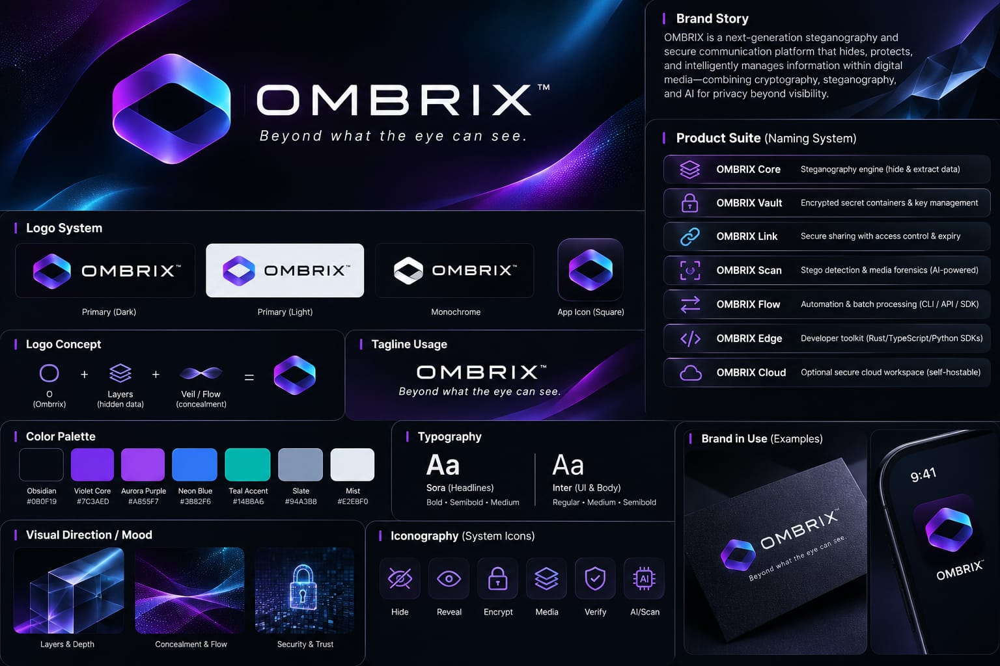

<div align="center">

# OMBRIX

### Zero-Knowledge Steganography & Visual Cryptanalysis Suite

Offline-first steganographic suite engineered for client-side execution — no network, no telemetry, no traces.

<br/>

[](https://ombrix-stego.vercel.app/)
[](https://www.npmjs.com/package/ombrix-cli)
[](https://www.npmjs.com/package/ombrix-mcp-server)
[](https://m8ven.ai/mcp/santhakumar-k-2004/ombrix?s=readme)
[](https://github.com/SanthaKumar-K-2004/OMBRIX/actions/workflows/ci.yml)
[](https://opensource.org/licenses/MIT)
[](https://github.com/SanthaKumar-K-2004/OMBRIX)

<br/>



</div>

---

## Overview

**OMBRIX** is an offline-first steganographic suite that conceals data inside carrier PNG images without leaving statistical or visual traces. All operations run entirely in the browser or locally — nothing ever leaves your device.

### Why Not Plain LSB?

Classic LSB tools overwrite sequential bits, introducing a **Pair-of-Values (PoV)** anomaly: even pixel values $2k$ shift only to $2k+1$ and vice-versa. This flattens the pixel histogram ($h(2k) \approx h(2k+1)$), making hidden data instantly detectable by **Chi-Square ($\chi^2$)**, **RS Steganalysis**, and **Sample Pair Analysis (SPA)**.

OMBRIX counters this across multiple domains:

- **±1 LSB Matching** — randomly increments or decrements pixels by 1 ($p' = p \pm 1$ where $p' \equiv m \pmod{2}$), preserving natural histogram contours
- **Pixel Value Differencing (PVD)** — allocates more bits to complex edge regions, fewer to smooth gradients
- **2D Haar DWT** — embeds into high-frequency wavelet subbands ($LH$, $HL$, $HH$) where human vision and steganalysis tools are least sensitive

---

## Pipeline Architecture

```
 CONCEALMENT (EMBED)                              EXTRACTION (EXTRACT)
 ┌──────────────────────────┐                    ┌──────────────────────────┐
 │     Plaintext / File     │                    │   Stego Carrier PNG      │
 └────────────┬─────────────┘                    └────────────┬─────────────┘
              │                                               │
              ▼                                               ▼
 ┌──────────────────────────┐                    ┌──────────────────────────┐
 │  OMB1 Envelope + Deflate │                    │  Lossless PNG Decode     │
 └────────────┬─────────────┘                    └────────────┬─────────────┘
              │                                               │
              ▼                                               ▼
 ┌──────────────────────────┐                    ┌──────────────────────────┐
 │  Argon2id KDF + ChaCha20 │                    │  Multi-Method Auto-Probe │
 │  + Poly1305 MAC          │                    │  (all 6 algorithms)      │
 └────────────┬─────────────┘                    └────────────┬─────────────┘
              │                                               │
              ▼                                               ▼
 ┌──────────────────────────┐                    ┌──────────────────────────┐
 │  Steganographic Engine   │                    │  Authenticated Decrypt   │
 │  (6 algorithms)          │                    │  + Heap Zeroize          │
 └────────────┬─────────────┘                    └────────────┬─────────────┘
              │                                               │
              ▼                                               ▼
 ┌──────────────────────────┐                    ┌──────────────────────────┐
 │  Lossless PNG Export     │                    │  Plaintext Recovered     │
 │  (EXIF & Metadata Purged)│                    │                          │
 └──────────────────────────┘                    └──────────────────────────┘
```

---

## 6 Steganography Algorithms

| Algorithm | Method | Best For | Capacity |
| :--- | :--- | :--- | :---: |
| **hyper-matrix** | 2D Haar DWT + PVD + ±1 Matching | Documents, photos, large payloads | ~15–25% |
| **robust-resilient** | YCbCr luminance blocks + 5× FEC | WhatsApp/Telegram as Photo (survives JPEG) | ~1.5–3 KB |
| **matching** | ±1 LSB Modulo | General photos, low distortion | ~12–20% |
| **pvd** | Pixel Value Differencing | High-contrast & urban photos | ~20–35% |
| **dwt** | Haar Wavelet subband | Camera captures, textures | ~10–18% |
| **lsb** | Sequential LSB | Synthetic test images | ~100% |

> **For WhatsApp/Telegram photos:** Use `robust-resilient` (survives recompression). For everything else: use `hyper-matrix` via **Send as Document**.

---

## Cryptographic Architecture

- **Key Derivation**: Argon2id (memory-hard, side-channel resistant)
- **Encryption**: ChaCha20-Poly1305 (authenticated encryption)
- **Integrity**: Poly1305 MAC per payload block
- **Passkeys**: Diceware 4-word phrases or 32-char crypto random
- **Memory**: Keys and plaintext are explicitly zeroized after use (`sodium.memzero`)
- **Privacy**: EXIF, GPS, camera serial, and device fingerprints stripped on export

---

## Security Guarantees

- **Zero network calls** — all processing runs in browser WebAssembly or local Node.js
- **Strict CSP** — `connect-src 'none'` blocks all outbound connections
- **Air-gapped by design** — no analytics, no telemetry, no crash reporting
- **PNG-only output** — JPEG is never written (lossy formats destroy hidden data)

---

## Getting Started

### Prerequisites

- **Node.js** `v20.0.0` or higher
- **pnpm** `v12.5.1` (`corepack enable && corepack install`)

### Install & Run

```bash
git clone https://github.com/SanthaKumar-K-2004/OMBRIX.git
cd OMBRIX
pnpm install
pnpm run dev
```

### Build

```bash
pnpm run build
```

---

## Command Line Interface (CLI)

```bash
# Embed a secret message
npx ombrix-cli embed cover.png -p "Secret message" -k "my-passkey" -m hyper-matrix -o stego.png

# Extract hidden message
npx ombrix-cli extract stego.png -k "my-passkey"

# Check capacity across 6 algorithms
npx ombrix-cli inspect cover.png

# Run forensic steganalysis (Chi-Square, RS, SPA)
npx ombrix-cli scan candidate.png

# Benchmark all algorithms on an image
npx ombrix-cli benchmark cover.png

# Generate a secure diceware passkey
npx ombrix-cli keygen diceware

# Run sandboxed Code Mode script
npx ombrix-cli eval "const cap = ombrix.inspect('cover.png'); return cap;"

# Register MCP server with Claude Desktop / Cursor / Antigravity
npx ombrix-cli mcp install
```

---

## MCP Server (AI Agents)

OMBRIX includes a zero-telemetry **MCP 2.0 server** for AI assistants (Claude Desktop, Cursor, Antigravity, Windsurf).

### Quick Start

```bash
npx ombrix-mcp-server
```

### Manual Config

Add to `~/.config/Claude/claude_desktop_config.json` (or your client's MCP config):

```json
{
  "mcpServers": {
    "ombrix": {
      "command": "npx",
      "args": ["-y", "ombrix-mcp-server"]
    }
  }
}
```

### 11 Available Tools

| Tool | Description |
|------|-------------|
| `stego_embed` | Hide data in a PNG (6 algorithms, optional passkey) |
| `stego_extract` | Extract hidden data with auto-detect or explicit method |
| `stego_inspect` | Capacity analysis per algorithm |
| `stego_scan` | Chi-square + RS steganalysis |
| `stego_benchmark` | Performance benchmark all 6 algorithms |
| `stego_keygen` | Generate diceware or crypto32 passkeys |
| `stego_plan` | Recommend algorithm based on channel (WhatsApp, email, print) |
| `stego_hide` | Simplified embed alias |
| `stego_reveal` | Simplified extract alias |
| `stego_code_mode` | Execute sandboxed Node.js steganography scripts |
| `stego_api_docs` | Return Code Mode API reference |

### Code Mode Example

```javascript
const carrier = ombrix.createCarrier(256, 256);
const key = await ombrix.keygen('diceware');
const result = await ombrix.embed(carrier, 'Secret message', {
  method: 'hyper-matrix',
  passkey: key.passkey
});
const scan = ombrix.scan(result.carrier);
return { verified: result.verified, anomalyScore: scan.overallAnomalyScore };
```

---

## Published npm Packages

| Package | Install | Description |
|---------|---------|-------------|
| `ombrix-mcp-server` | `npx ombrix-mcp-server` | MCP 2.0 server (stdio) |
| `ombrix-cli` | `npx ombrix-cli` | Command line interface |

---

<div align="center">
  <sub>OMBRIX • Zero-Telemetry Forensic Steganography Suite • MIT License</sub>
</div>
